# Entity-relationship diagram

<!-- Generated by tools/gen_erd.py from backend/app/models. Do not edit by hand; run `make erd`. -->

Schema from plan §6.1. Every table also has `created_at`. Tables marked *(src)* also
keep `source_upload_id → upload_files`, `source_row` and `source_payload` (CLAUDE.md
rule 5); those columns and their links to `upload_files` are left out of the diagram
to keep it readable.

- **Master data:** `customers` *(src)*, `products` *(src)*, `ssp_rules` *(src)*, `gl_accounts`, `gl_mappings`
- **Contracts:** `contracts`, `contract_versions` *(src)*, `contract_lines` *(src)*, `performance_obligations`, `deliveries` *(src)*
- **Billing:** `invoices` *(src)*, `invoice_lines` *(src)*, `credit_notes` *(src)*
- **Revenue:** `revenue_schedules`, `schedule_lines`
- **Ledger:** `accounting_periods`, `journal_batches`, `journal_entries`, `journal_lines`
- **Control:** `upload_files`, `validation_errors`, `job_runs`, `audit_log`, `users`, `roles`, `user_roles`

```mermaid
erDiagram
    customers {
        bigint id PK
        varchar_64 customer_code UK
        varchar_255 name
        varchar_2 country
    }
    products {
        bigint id PK
        varchar_128 product_code UK
        varchar_255 name
        varchar_64 category "nullable"
        numeric_18_2 list_price
        recognition_method recognition_method
        boolean is_separate_obligation
        bigint revenue_account_id FK
    }
    ssp_rules {
        bigint id PK
        bigint product_id FK
        ssp_source ssp_source
        numeric_18_2 ssp_value "nullable"
        numeric_7_4 ssp_pct "nullable"
        date valid_from
        date valid_to "nullable"
    }
    gl_accounts {
        bigint id PK
        varchar_32 account_code UK
        varchar_255 name
        gl_account_type type
        boolean is_active
    }
    gl_mappings {
        bigint id PK
        account_role account_role
        bigint product_id FK "nullable"
        varchar_64 product_category "nullable"
        bigint account_id FK
    }
    contracts {
        bigint id PK
        varchar_64 contract_code UK
        bigint customer_id FK
        contract_status status
        integer current_version_no
    }
    contract_versions {
        bigint id PK
        bigint contract_id FK
        integer version_no
        contract_event_type event_type
        date effective_date
        date start_date
        date end_date
        numeric_18_2 transaction_price
        varchar_6 booked_period
    }
    contract_lines {
        bigint id PK
        bigint contract_version_id FK
        integer line_no
        bigint product_id FK
        numeric_12_4 quantity
        numeric_18_2 unit_price
        numeric_18_2 discount
        numeric_18_2 net_price
        date service_start
        date service_end
        date completion_date "nullable"
    }
    performance_obligations {
        bigint id PK
        bigint contract_version_id FK
        bigint contract_line_id FK
        bigint product_id FK
        recognition_method method
        numeric_18_2 ssp_amount
        numeric_18_2 allocated_amount
        date service_start
        date service_end
        date completion_date "nullable"
        bigint carried_from_po_id FK "nullable"
        obligation_status status
    }
    deliveries {
        bigint id PK
        varchar_64 delivery_code UK
        bigint contract_line_id FK
        date delivery_date
        numeric_9_6 units_fraction
    }
    invoices {
        bigint id PK
        varchar_64 invoice_number UK
        bigint contract_id FK
        date invoice_date
        numeric_18_2 total_amount
    }
    invoice_lines {
        bigint id PK
        bigint invoice_id FK
        bigint contract_line_id FK "nullable"
        integer line_no
        numeric_18_2 amount
    }
    credit_notes {
        bigint id PK
        varchar_64 credit_note_number UK
        bigint invoice_id FK
        date credit_date
        numeric_18_2 amount
        text reason
    }
    revenue_schedules {
        bigint id PK
        bigint performance_obligation_id FK
        bigint contract_version_id FK
        schedule_status status
        bigint generated_by_job_id FK "nullable"
    }
    schedule_lines {
        bigint id PK
        bigint schedule_id FK
        varchar_6 service_period
        numeric_18_2 amount
        schedule_line_status status
        varchar_6 posting_period "nullable"
        boolean is_catch_up
        bigint journal_line_id FK "nullable"
    }
    accounting_periods {
        bigint id PK
        varchar_6 period_key UK
        date start_date
        date end_date
        period_status status
        bigint closed_by FK "nullable"
        timestamptz closed_at "nullable"
    }
    journal_batches {
        bigint id PK
        bigint period_id FK
        integer batch_no
        batch_status status
        bigint generated_by FK
        bigint approved_by FK "nullable"
        timestamptz approved_at "nullable"
        bigint posted_by FK "nullable"
        timestamptz posted_at "nullable"
        numeric_18_2 total_debit
        numeric_18_2 total_credit
    }
    journal_entries {
        bigint id PK
        bigint batch_id FK
        journal_entry_type entry_type
        date entry_date
        bigint contract_id FK
        bigint contract_version_id FK
        varchar_32 source_type
        bigint source_id "nullable"
        bigint reverses_entry_id FK "nullable"
        text description "nullable"
    }
    journal_lines {
        bigint id PK
        bigint entry_id FK
        bigint account_id FK
        numeric_18_2 debit
        numeric_18_2 credit
        bigint product_id FK "nullable"
        bigint performance_obligation_id FK "nullable"
    }
    upload_files {
        bigint id PK
        upload_template template
        varchar_255 original_filename
        varchar_64 sha256
        varchar_1024 stored_path
        bigint uploaded_by FK
        varchar_6 period_key
        upload_status status
        integer total_rows
        integer accepted_rows
        integer rejected_rows
    }
    validation_errors {
        bigint id PK
        bigint upload_file_id FK
        integer row_number
        varchar_64 column_name "nullable"
        varchar_4 error_code
        text message
        text raw_value "nullable"
    }
    job_runs {
        bigint id PK
        job_type job_type
        job_status status
        jsonb params
        integer progress
        jsonb result "nullable"
        text error "nullable"
        bigint created_by FK "nullable"
        timestamptz started_at "nullable"
        timestamptz finished_at "nullable"
    }
    audit_log {
        bigint id PK
        timestamptz at
        bigint user_id FK "nullable"
        varchar_64 action
        varchar_64 entity_type
        varchar_64 entity_id "nullable"
        jsonb before "nullable"
        jsonb after "nullable"
        text reason "nullable"
    }
    users {
        bigint id PK
        varchar_320 email UK
        varchar_255 full_name
        varchar_255 password_hash
        boolean is_active
    }
    roles {
        bigint id PK
        varchar_32 name UK
    }
    user_roles {
        bigint id PK
        bigint user_id FK
        bigint role_id FK
    }

    products }o--|| gl_accounts : revenue_account_id
    ssp_rules }o--|| products : product_id
    gl_mappings }o--o| products : product_id
    gl_mappings }o--|| gl_accounts : account_id
    contracts }o--|| customers : customer_id
    contract_versions }o--|| contracts : contract_id
    contract_lines }o--|| contract_versions : contract_version_id
    contract_lines }o--|| products : product_id
    performance_obligations }o--|| contract_versions : contract_version_id
    performance_obligations }o--|| contract_lines : contract_line_id
    performance_obligations }o--|| products : product_id
    performance_obligations }o--o| performance_obligations : carried_from_po_id
    deliveries }o--|| contract_lines : contract_line_id
    invoices }o--|| contracts : contract_id
    invoice_lines }o--|| invoices : invoice_id
    invoice_lines }o--o| contract_lines : contract_line_id
    credit_notes }o--|| invoices : invoice_id
    revenue_schedules }o--|| performance_obligations : performance_obligation_id
    revenue_schedules }o--|| contract_versions : contract_version_id
    revenue_schedules }o--o| job_runs : generated_by_job_id
    schedule_lines }o--|| revenue_schedules : schedule_id
    schedule_lines }o--o| journal_lines : journal_line_id
    accounting_periods }o--o| users : closed_by
    journal_batches }o--|| accounting_periods : period_id
    journal_batches }o--|| users : generated_by
    journal_batches }o--o| users : approved_by
    journal_batches }o--o| users : posted_by
    journal_entries }o--|| journal_batches : batch_id
    journal_entries }o--|| contracts : contract_id
    journal_entries }o--|| contract_versions : contract_version_id
    journal_entries }o--o| journal_entries : reverses_entry_id
    journal_lines }o--|| journal_entries : entry_id
    journal_lines }o--|| gl_accounts : account_id
    journal_lines }o--o| products : product_id
    journal_lines }o--o| performance_obligations : performance_obligation_id
    upload_files }o--|| users : uploaded_by
    validation_errors }o--|| upload_files : upload_file_id
    job_runs }o--o| users : created_by
    audit_log }o--o| users : user_id
    user_roles }o--|| users : user_id
    user_roles }o--|| roles : role_id
```

