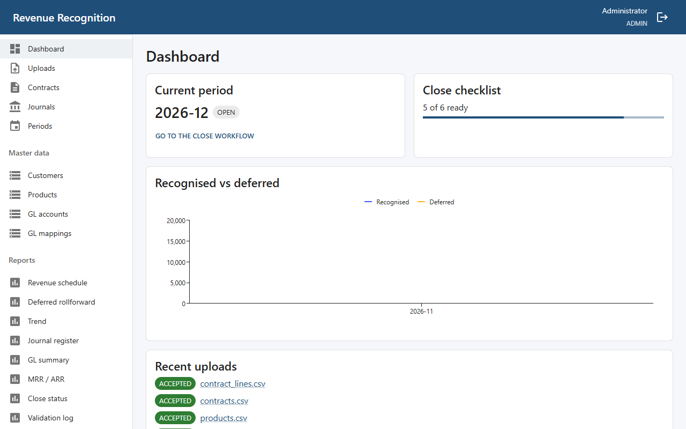
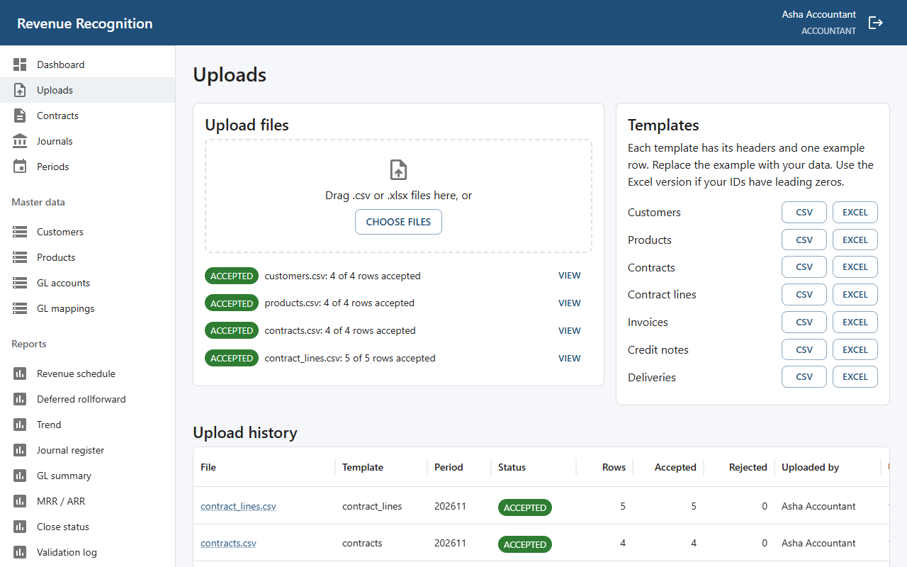
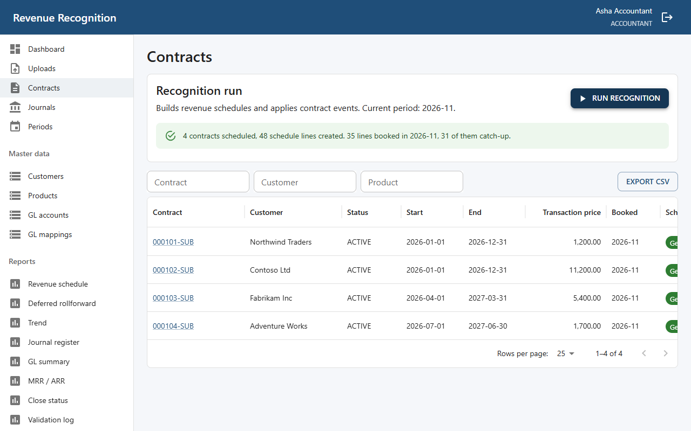
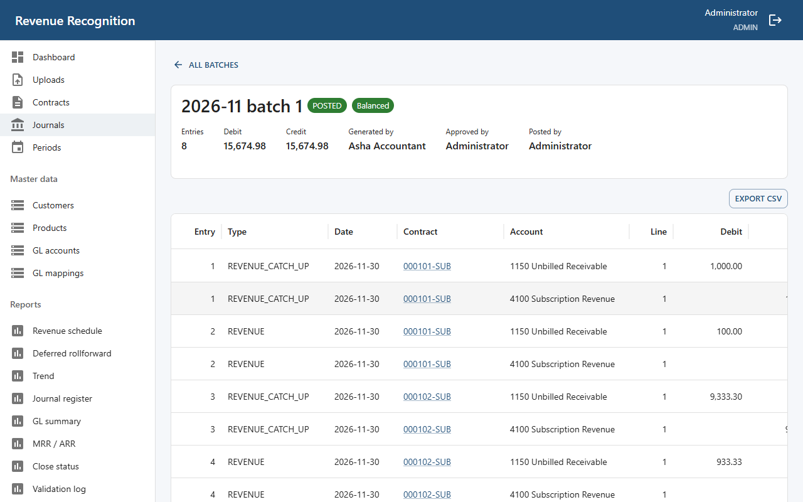
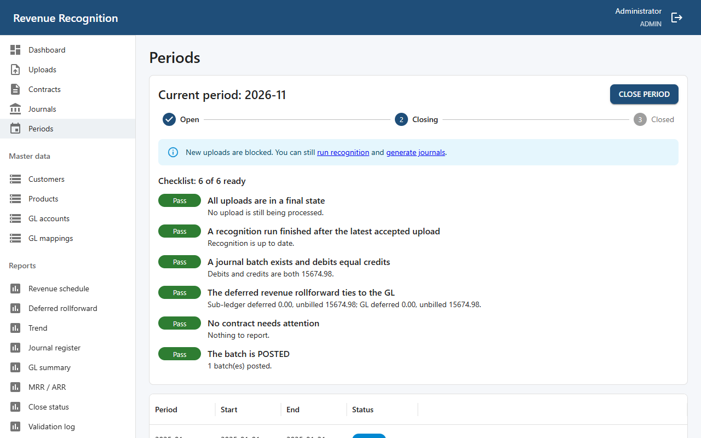
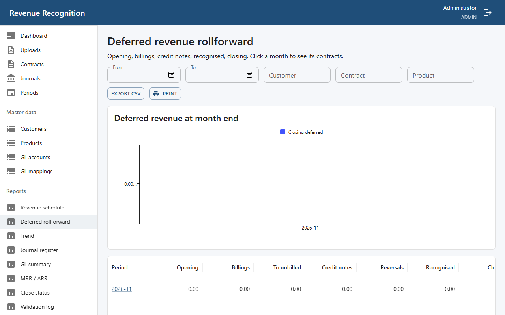

# User manual

This system turns subscription contracts and billing files into revenue schedules, balanced journals, a closed month and reports.

To install it, follow the [README](../README.md). Then open http://localhost:3000 and sign in.

## Who can do what

| Role | Can do |
|---|---|
| **Uploader** | Upload files, see contracts and the validation log |
| **Accountant** | Also: run recognition, generate journals, book reversals, start a close, see all reports |
| **Approver** | Also: approve, send back and post journal batches; close a period |
| **Admin** | Also: manage users; reopen a period |

The person who generates a batch cannot approve it, so a month needs at least two people, for example an accountant and an approver.

Admins create users through the API, at http://localhost:8000/docs under `POST /api/v1/users`. Passwords need at least 12 characters, with a capital, a small letter and a digit. After 5 wrong passwords, that email must wait 5 minutes.

## The month, step by step

Only one period is open at a time. Its month is shown on the dashboard and on **Periods**.

### 1. Upload

Go to **Uploads**. Download a template if you need one, then drop your files on the page and click **Upload**. You can send several files together; a contract and its lines must be in the same upload.

Each file ends as one of these:

| Status | Meaning |
|---|---|
| **ACCEPTED** | Every row loaded |
| **PARTIAL** | Good rows loaded; click **View errors** for the rest |
| **REJECTED** | Nothing loaded |

If any row of a contract fails, the whole contract is held back. Fix the rows in your file and upload them again. Rows that already loaded must not be sent again, or they are rejected as duplicates.

### 2. Run recognition

Go to **Contracts** and click **Run recognition**. It builds schedules for new contracts, applies renewals, cancellations and upgrades, and books the revenue due this month. Running it twice is safe.

Click a contract to see its schedule, lines, allocation, versions, billing, journal lines and the uploaded rows behind it.

A warning under the result names any contract that could not be processed, and why. **Catch-up** on a schedule line means revenue earned in an earlier month, booked now because earlier months are closed.

### 3. Generate journals

Go to **Journals** and click **Generate journals**. Generating again rebuilds a draft batch.

### 4. Approve and post

Someone other than the generator opens the batch, checks that it shows **Balanced**, and clicks **Approve**, then **Post**. An approver can click **Send back** before posting.

**Posting cannot be undone.** To correct a posted entry, click **Reverse** beside it and give a reason. This creates a new draft batch that needs approving and posting too. The reversal corrects the ledger only: it does not change the schedule, and reversed revenue is not booked again automatically.

### 5. Close the period

Go to **Periods**, and click **Start close**. New uploads are now blocked, but you can still run recognition and generate journals. Work through the checklist:

| Item | If it is not ready |
|---|---|
| All uploads final | Wait for processing to finish |
| Recognition after the latest upload | Run recognition |
| Batch exists and balances | Generate journals |
| Rollforward ties to the GL | Post the batch; if it still fails, investigate before closing |
| No contract needs attention | A warning only: read it, it does not block the close |
| Batch posted | Approve and post it |

An approver then clicks **Close period**, and the next month opens.

An admin can **Reopen** the latest closed period, with a reason, unless the next period already has a posted batch.

## Reports

Every report has filters, **Export CSV** (all rows, not just the page) and **Print**.

| Report | Shows |
|---|---|
| **Revenue schedule** | Revenue per contract line per month |
| **Deferred rollforward** | Opening, billings, credit notes, recognised, closing. Click a month to see its contracts |
| **Trend** | Monthly recognised revenue and the deferred balance |
| **Journal register** | Every journal line |
| **GL summary** | Debit, credit and net per account per period. Click a period to see its lines |
| **MRR / ARR** | Recurring revenue. This is non-GAAP, not recognised revenue |
| **Close status** | The state of each period, and the current checklist |
| **Validation log** | Every error from every upload |

To trace a figure to its source, click through to the contract and open **Source rows**, which shows the file, the row number and the row as it was uploaded.

## Common problems

| Problem | What to do |
|---|---|
| The site does not open | Check Docker Desktop is running, then run `docker compose up -d` and wait 30 seconds |
| An upload stays at 0% | Run `docker compose restart worker` |
| "Uploads are blocked" | The period is closing. Finish the close, or wait for the next period |
| `E009` on a credit note | The credit is more than the deferred balance when it is processed, by date then number. Check its date against the invoice |
| `E010` on an event | Cancellations and upgrades cannot take effect in a closed period |
| `E012` on a monthly product | It needs whole months: start on the 1st and end on a month end. A cancellation needs a month end, and an upgrade needs the 1st |
| Approve is greyed out | You generated this batch, so someone else must approve it |
| "Too many failed attempts" | Wait 5 minutes |
